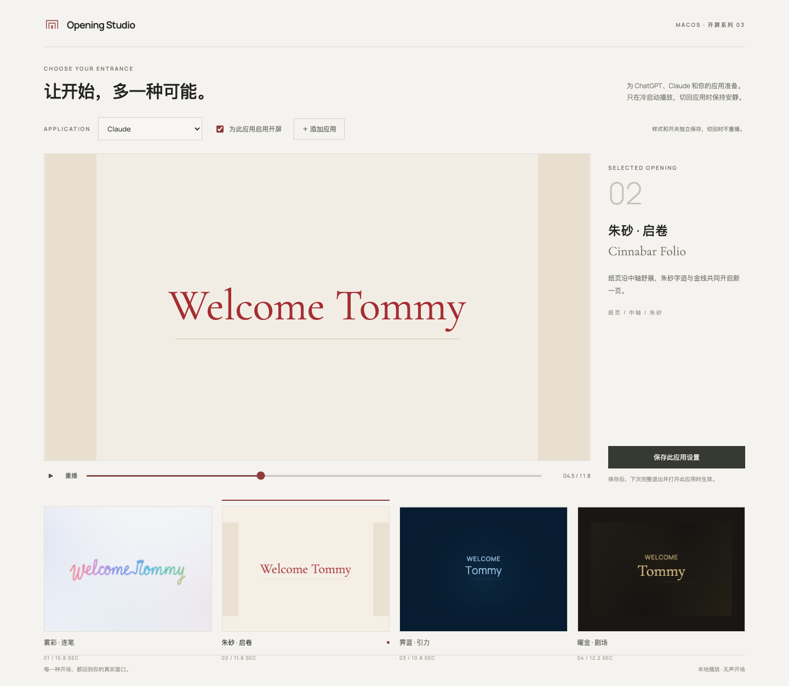

# Opening Studio

为 **ChatGPT、Claude 和其他 macOS 应用**添加开场动画：只在进程冷启动时播放，跟随窗口大小和位置，最后进入真实应用。每个软件独立选择样式和开关。



## 四种样式

| 样式 | 动效 | 时长 |
| --- | --- | --- |
| 雾彩 · 连笔 | 磨砂底色，连续彩线写出 Welcome Tommy | 15.8 秒 |
| 朱砂 · 启卷 | 暖纸中轴展开，朱砂字与细金线 | 11.8 秒 |
| 霁蓝 · 引力 | 深蓝地平线，环绕轨道 | 10.8 秒 |
| 曜金 · 剧场 | 暗暖幕光，金色衬线字 | 12.2 秒 |

ChatGPT 使用六瓣编织结，Claude 使用官网星芒图形，其他应用使用环形入口与本机应用图标。四种样式均无声，当前问候语固定为 **Welcome Tommy**。

## 安装

在 [GitHub Releases](https://github.com/okiexia-ui/opening-studio/releases) 下载正式发布后的安装包。草稿 Release 仅仓库维护者可见；在正式发布前可以从源码构建。

1. 解压 `OpeningStudio-v0.3.0-macos-universal.zip`，保持文件夹结构。
2. 双击 `安装 Opening Studio.command`，安装脚本需要 Python 3。
3. 在菜单栏圆点环图标中打开 **应用与开屏…**。
4. 选择软件、样式和开关，点击 **保存此应用设置**。
5. 完整退出目标软件后重新打开，播放一次。切回、恢复窗口和重复点击已运行的软件均不重播。

支持 macOS 13+，提供 Apple Silicon / Intel 通用二进制；实际运行验证在 Apple Silicon 上完成。当前二进制使用 ad-hoc 签名，未做 Developer ID 公证，互联网下载可能受到 Gatekeeper 限制。

默认启用新版 ChatGPT 和 Claude；保留升级前的 ChatGPT 样式。另有 ChatGPT Classic、VS Code、Obsidian、OpenCode、Slack 预设，默认关闭。通过 **添加应用** 可以选择其他普通 `.app`。应用兼容范围、配置位置和验证边界见 [应用适配说明](docs/APPS.md)。

## 工作方式

一个 Swift 伴随程序监听 `NSWorkspace` 启动事件，按 PID 去重。非激活的透明 `NSPanel` 承载磨砂背景和本地 `WKWebView`，从标志中央打开透明孔径，露出真实窗口。多个软件接连启动时只保留一层动画。

不修改目标应用，不替换原始 Dock 图标，不读取聊天内容，播放时不联网，也不要求辅助功能或录屏权限。仅读取应用启动事件、图标和窗口几何信息。

MP4 与原生动画使用同一渲染器。MP4 为 1920×1080 / 60 fps 的固定画幅展示，结尾为纯色；原生动画适配当前窗口并以透明方式退出。安装位置沿用 `~/Library/Application Support/WelcomeTommy/`，日志限制在约 1 MB，配置仅保存在本机。

## 源码构建

原生应用需要 macOS、Xcode Command Line Tools 和 Python 3，不需要 Node：

```sh
zsh scripts/build-native.sh --universal
python3 scripts/install.py
```

视频编辑与渲染检查还需要 Node 22+ 和 Chrome / Chromium。可用 `HYPERFRAMES_BROWSER_PATH` 指定浏览器。

```sh
npm ci
python3 scripts/make-variants.py
npm run check
python3 scripts/test-integration.py
node scripts/hf.cjs preview variants/claude --background
node scripts/hf.cjs check variants/claude --json
node scripts/hf.cjs render variants/claude --quality delivery --fps 60 -o '../delivery/Claude Cinnabar.mp4'
python3 scripts/package-release.py
```

视频入口包括 `cinnabar`、`midnight`、`aurum`、`claude`；省略 variants 参数为原始连笔版。`film/gallery.html` 是可独立预览的页面，本机设置由原生菜单栏选择器保存。也可在 [HyperFrames 桌面应用](https://hyperframes.studio/studio/download?src=cli) 中继续编辑。

连笔文字在 `film/assets/lettering.js` 中，需要重新绘制路径才能改名字；其他三版文字在 `premium.js` 中。主题时长位于 `themes.js` 与 `native/AppProfiles.swift`，修改时需保持一致。

## 验证与授权

覆盖三种标志、四种主题、五种窗口比例、透明退出、设置隔离、取消播放竞态和选择器交互。两个独立测试应用覆盖冷启动、窗口缩放、关闭单个适配、保存重启、不重播和并发接替。真实第三方软件未被强制退出做逐个冷启动测试；跨 Spaces、全屏与多屏的所有组合仍有待验证。

原有连笔速度为舒缓的 Apple hello 风格复刻，并非测量过的 iOS 18 逐帧复制。新增配色与构图见 [设计说明](docs/DESIGN.md)。

原创代码采用 [MIT](LICENSE)。字体、商标、图形和视频工具分别适用自身条款，详见 [第三方说明](THIRD_PARTY_NOTICES.md)。本项目不隶属 OpenAI、Anthropic、Apple 或所适配的软件厂商。

[发布说明](docs/RELEASE_NOTES.md) · [构建和发布流程](docs/PUBLISHING.md)
