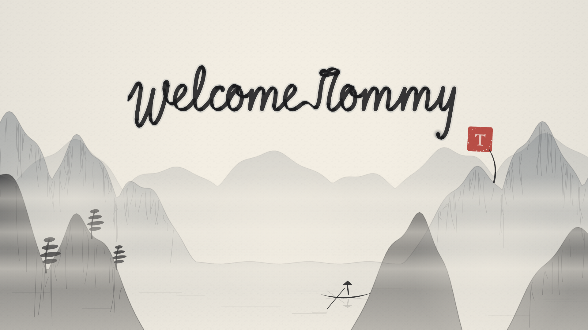
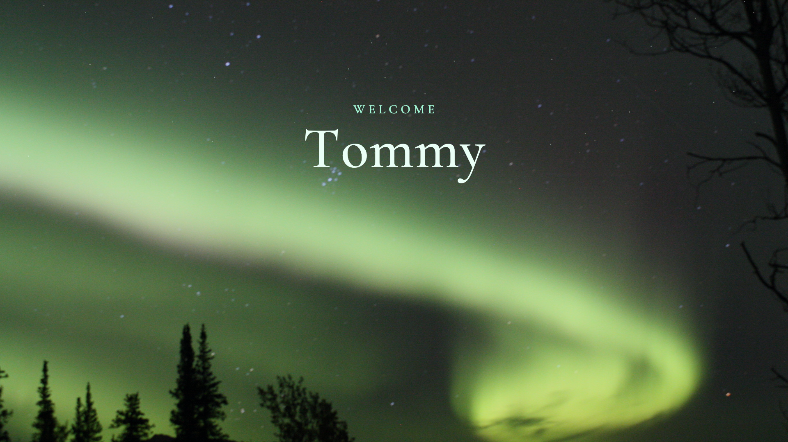
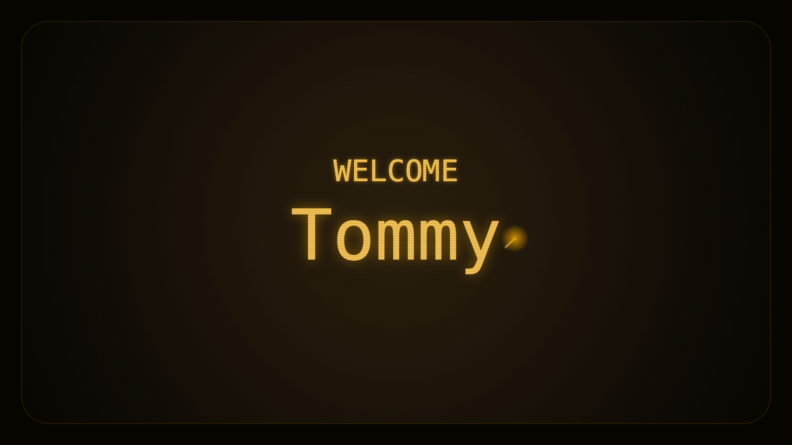
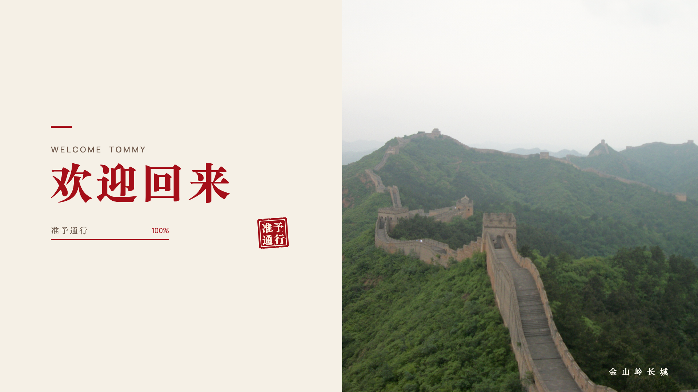
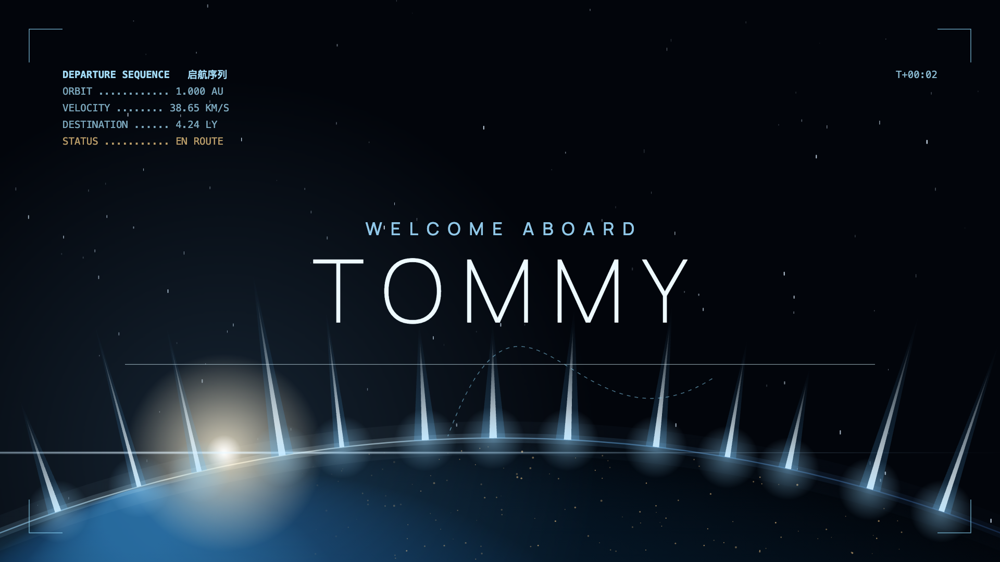
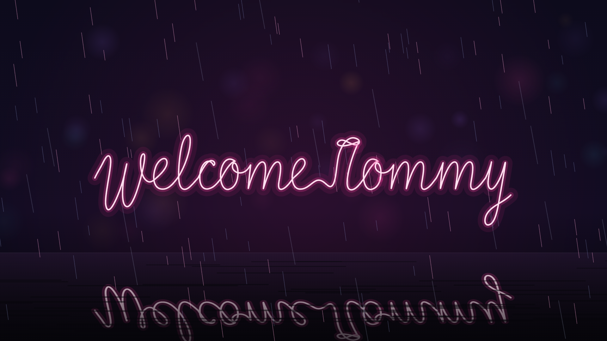
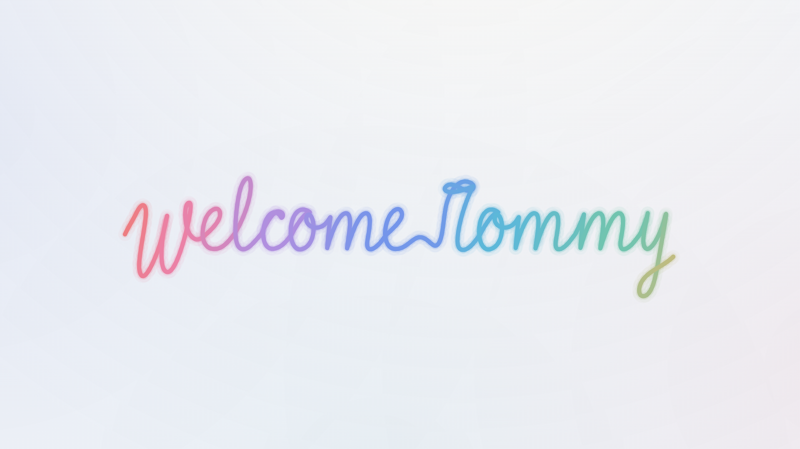

# Opening Studio

为 **ChatGPT、Claude 和其他 macOS 应用**添加开场动画：只在进程冷启动时播放，跟随窗口大小和位置，最后进入真实应用。每个软件独立选择样式和开关。


## 八种样式

| 样式 | 动效 | 时长 |
| --- | --- | --- |
| 雾彩 · 连笔 | 磨砂底色，连续彩线写出 Welcome Tommy | 15.8 秒 |
| 水墨 · 山水 | 墨滴在宣纸上晕开成山，小舟穿雾；毛笔按笔锋写出名字，钤上名字印，再一笔勾出标志 | 12.4 秒 |
| 极光 · 冰原 | 冰原夜空亮起极光，光幕摇曳间名字逐字凝出，再收成一缕光描出标志 | 12.0 秒 |
| 磷光 · 终端 | 旧显像管预热，开机自检滚过，光标敲出名字，光束像示波器一样描出标志 | 11.4 秒 |
| 长城 · 通行 | 宣纸朝阳、祥云与长城展开，朱红标题揭幕；身份认证走到 100%，“准予通行”印章落下，红线从印章引向标志 | 12.6 秒 |
| 星烛 · 咒语 | 星穹下浮烛次第点亮，一缕咒光凌空写下名字，火花散落，再飞去描出标志 | 13.6 秒 |
| 星际 · 远航 | 晨光越过行星边缘，3-2-1 倒计时，推进器沿地平线点火，航迹锁定标志后跃迁 | 12.8 秒 |
| 霓虹 · 雨夜 | 雨夜霓虹灯管闪烁亮起，一个字母接触不良，电流沿灯管流进标志，积水里有倒影 | 11.6 秒 |

<table><tr>
<td></td><td></td>
</tr><tr>
<td></td><td></td>
</tr><tr>
<td></td><td></td>
</tr><tr>
<td></td><td></td>
</tr></table>

ChatGPT 使用六瓣编织结，Claude 使用官网星芒图形，其他应用使用环形入口与本机应用图标。八种样式均无声，默认问候为 **Welcome Tommy**，可以改成你自己的（见下）。“长城 · 通行”沿用作者 [dsh-gov-boot](https://github.com/okiexia-ui/dsh-gov-boot) 片头的美术语言；其余均为原创美术，只取题材气质，不含任何影视作品的名称、标志、角色或字体。旧版的朱砂 · 启卷、霁蓝 · 引力、曜金 · 剧场已由水墨、极光、终端取代，原先选它们的应用会自动换成对应的新样式。

## 自定义问候

在 **应用与开屏…** 的 GREETING 一行修改，边改边预览，点 **保存问候** 后对所有应用和样式生效：

| 字段 | 默认 | 用在 | 上限 |
| --- | --- | --- | --- |
| 问候语 | Welcome | 所有样式（部分样式的标题行转为大写） | 16 字 |
| 名字 | Tommy | 所有样式 | 16 字 |
| 政务标题 | 欢迎回来 | 长城 · 通行 的朱红大字 | 12 字 |
| 印章 | 准予通行 | 长城 · 通行 的印章，1–4 字 | 4 字 |

连笔、水墨、星烛、霓虹是“一笔写出”的样式：默认的 Welcome Tommy 使用手工绘制的笔迹；换成其他文字、字体或两行排版时，会用所选字体（中文用楷体）当场生成单线笔迹，再按书写顺序描出，中文名字也可以。字体类样式会按长度自动缩小。问候只保存在本机 `profiles.json` 的 `greeting` 字段；也可以在浏览器里打开 `film/gallery.html?name=Ada&greeting=Hello` 预览。

## 定制样式

每种样式都可以单独定制，保存后所有使用这种样式的应用一起生效。在 **应用与开屏…** 选中样式后，下方的 **CUSTOMIZE THIS STYLE** 面板提供：

| 选项 | 说明 |
| --- | --- |
| 配色 | 每种样式 3–5 套配色，另可自选主色（连笔样式会按主色生成一整条渐变） |
| 节奏 | 舒缓 / 标准 / 利落，整体时长 ×1.22 / ×1 / ×0.78，窗口转场同步调整 |
| 字体 | 连笔、花体、手写、楷体、衬线、宋体、无衬线、等宽中的若干种，视样式而定 |
| 排版与字号 | 一行或两行（问候在上、名字在下），字号 75%–125% |
| 场景元素 | 每种样式自己的开关和强度：例如水墨的远山层次、云雾、小舟、印章；极光的光幕强度、星空、冰原、流星；终端的扫描线、屏幕弧度、开机自检、闪烁；长城的长城、祥云、身份认证、印章、红绸；星烛的浮烛数量、火花；远航的推进器、倒计时、仪表、星流；霓虹的雨势、倒影、接触不良 |

边改边预览，缩略图同步更新；**恢复默认** 一键还原。只保存与默认不同的选项，存放在本机 `profiles.json` 的 `styles` 字段。

## 安装

在 [GitHub Releases](https://github.com/okiexia-ui/opening-studio/releases) 下载最新安装包（当前为 v0.3.0），也可以从源码构建。

1. 解压 `OpeningStudio-v0.3.0-macos-universal.zip`，保持文件夹结构。
2. 双击 `安装 Opening Studio.command`。只使用 macOS 自带工具，无需 Python 或 Xcode。
3. 在菜单栏圆点环图标中打开 **应用与开屏…**。
4. 选择软件、样式和开关，点击 **保存此应用设置**。
5. 完整退出目标软件后重新打开，播放一次。切回、恢复窗口和重复点击已运行的软件均不重播。

支持 macOS 13+，提供 Apple Silicon / Intel 通用二进制；实际运行验证在 Apple Silicon 上完成。

> 当前安装包使用 ad-hoc 签名，尚未取得 Apple 公证。安装器保留下载来源标记。如果系统提示无法验证开发者，请参阅 [Apple 的 macOS 应用安全说明](https://support.apple.com/zh-cn/102445)。

升级前会先校验新包。登录项启动失败会恢复上一版，已经关闭的登录项在升级后继续保持关闭。

### 暂停、退出与卸载

| 操作 | 方式 |
| --- | --- |
| 暂停全部开屏 | 菜单栏 › **暂停全部开屏**，设置保留 |
| 关闭单个应用 | **应用与开屏…** 中取消该应用的开关并保存 |
| 退出 | 菜单栏 › **退出 Opening Studio**，下次登录时自动恢复 |
| 停用登录项 | `delivery/关闭开场动画.command`；用 `重新启用开场动画.command` 恢复 |
| 卸载 | `delivery/卸载 Opening Studio.command`，删除应用和登录项，保留设置与日志，并打印彻底清除的命令 |

### 排查

- 事件日志：`~/Library/Logs/WelcomeTommy/events.jsonl`，约 1 MB 轮换一次，保留上一份。`cold_launch_detected`、`animation_started`、`animation_finished` 的 `reason` 字段说明每次是否播放、为何结束。
- 查看某个应用能否读到窗口位置：`"$HOME/Library/Application Support/WelcomeTommy/Welcome Tommy.app/Contents/MacOS/WelcomeTommy" --diagnose --target com.anthropic.claudefordesktop`
- 没有播放：确认目标软件已**完整退出**（⌘Q，而不只是关闭窗口）再打开；已在运行的进程不会补播。

默认启用新版 ChatGPT 和 Claude；保留升级前的 ChatGPT 样式。另有 ChatGPT Classic、VS Code、Obsidian、OpenCode、Slack 预设，默认关闭。通过 **添加应用** 可以选择其他普通 `.app`。应用兼容范围、配置位置和验证边界见 [应用适配说明](docs/APPS.md)。

## 工作方式

一个 Swift 伴随程序监听 `NSWorkspace` 启动事件，按 PID 去重。非激活的透明 `NSPanel` 承载磨砂背景和本地 `WKWebView`，从标志中央打开透明孔径，露出真实窗口。多个软件接连启动时只保留一层动画。

不修改目标应用，不替换原始 Dock 图标，不读取聊天内容，播放时不联网，也不要求辅助功能或录屏权限。仅读取应用启动事件、图标和窗口几何信息。

MP4 与原生动画使用同一渲染器。MP4 为 1920×1080 / 60 fps 的固定画幅展示，结尾为纯色；原生动画适配当前窗口并以透明方式退出。安装位置沿用 `~/Library/Application Support/WelcomeTommy/`，保留上一版为 `Welcome Tommy.previous.app`，配置仅保存在本机。

## 源码构建

原生应用只需要 macOS 和 Xcode Command Line Tools，不需要 Node：

```sh
zsh scripts/build-native.sh --universal
zsh scripts/install.sh
```

集成测试与打包脚本另需 Python 3。

视频编辑与渲染检查还需要 Node 22+ 和 Chrome / Chromium。可用 `HYPERFRAMES_BROWSER_PATH` 指定浏览器。

```sh
npm ci
python3 scripts/make-variants.py
npm run check
python3 scripts/test-integration.py
node scripts/hf.cjs preview variants/claude --background
node scripts/hf.cjs check variants/claude --json
node scripts/hf.cjs render variants/claude --quality delivery --fps 60 -o '../delivery/Claude Ink.mp4'
python3 scripts/package-release.py
```

视频入口包括 `ink`、`aurora`、`terminal`、`claude`、`civic`、`spell`、`voyage`、`neon`（均为默认选项）；省略 variants 参数为原始连笔版。`film/gallery.html` 是可独立预览的页面，本机设置由原生菜单栏选择器保存。也可在 [HyperFrames 桌面应用](https://hyperframes.studio/studio/download?src=cli) 中继续编辑。

连笔、星烛、霓虹共用一条笔迹：默认问候来自 `film/assets/lettering.js` 的手绘路径，其他文字由 `film/assets/handwriting.js` 生成（字体光栅化 → Zhang–Suen 细化 → 按书写顺序连成单线，抬笔段不绘制）。雾彩在 `renderer.js` 中绘制，其余七种在 `film/assets/stages.js` 中各自登记，共用 `premium.js` 的交接骨架（问候 → 连线 → 描出标志 → 穿过标志进入窗口）。每种样式可定制什么写在 `film/assets/themes.js` 里，`film/assets/style.js` 负责校验和配色。新增样式时在 `stages.js` 写一个函数，并在 `themes.js`、`native/AppProfiles.swift`、`scripts/make-variants.py` 登记。

## 验证与授权

测试覆盖三种标志、八种主题、五种窗口比例和透明退出，以及每种样式的全部配色、主色、节奏、场景元素开到最小和最大、全部字体、排版和字号。两个独立测试应用验证后台启动、窗口缩放、关窗重开与连续启动。Apple Silicon 实机上，Claude 完整播放了 11.8 秒的朱砂开屏（重设计前的默认样式），再次点开同一进程没有重播。多屏、Spaces 和全屏组合的验证范围见[应用适配说明](docs/APPS.md)。

原有连笔速度为舒缓的 Apple hello 风格复刻，并非测量过的 iOS 18 逐帧复制。新增配色与构图见 [设计说明](docs/DESIGN.md)。

原创代码采用 [MIT](LICENSE)。字体、商标、图形和视频工具分别适用自身条款，详见 [第三方说明](THIRD_PARTY_NOTICES.md)。本项目不隶属 OpenAI、Anthropic、Apple 或所适配的软件厂商。

[发布说明](docs/RELEASE_NOTES.md) · [构建和发布流程](docs/PUBLISHING.md)

## English

Opening Studio adds a silent opening animation to ChatGPT, Claude and other macOS apps. It plays only on a cold process launch, follows the app's real window, and ends by opening a transparent aperture onto it. Switching back to a running app never replays it. Each app gets its own style and on/off switch.

- Unzip the release, keep the folder structure and open `安装 Opening Studio.command`. The installer uses tools included with macOS and preserves download provenance. The build has an ad-hoc signature and awaits Apple notarization. [Apple's guide to opening downloaded apps](https://support.apple.com/en-us/102445)
- **Use:** choose apps and one of eight styles from the menu-bar dotted-circle icon › 应用与开屏… (apps & openings). Styles: Frosted Script, Ink Landscape, Aurora Field, Phosphor Terminal, Great Wall Pass, Candlelit Spell, Planetary Voyage and Neon Rain. Each style can be customised (palette or your own accent colour, pace, font, one- or two-line layout, size, and its own scene elements) with a live preview.
- **Quit / uninstall:** menu bar › 退出 Opening Studio (quit) stops it until next login. `delivery/卸载 Opening Studio.command` (uninstall) removes the app and login item and keeps your settings.
- **Privacy:** no network access during playback, and no Accessibility or Screen Recording permission. It reads only launch events, app icons and window bounds, and never chat content.
- **Build from source:** `zsh scripts/build-native.sh --universal && zsh scripts/install.sh`. Renderer tests: `npm ci && npm run check` (Node 22+, Chrome).

The greeting is editable: set the greeting word, your name, the Great Wall Pass title and its seal under GREETING in the settings window. Handwritten styles trace any phrase, Chinese included, from a system script face; the default “Welcome Tommy” keeps its hand-drawn path. The project is not affiliated with OpenAI, Anthropic, Apple or any adapted app vendor. MIT for original code. See [third-party notices](THIRD_PARTY_NOTICES.md) for fonts and marks.
